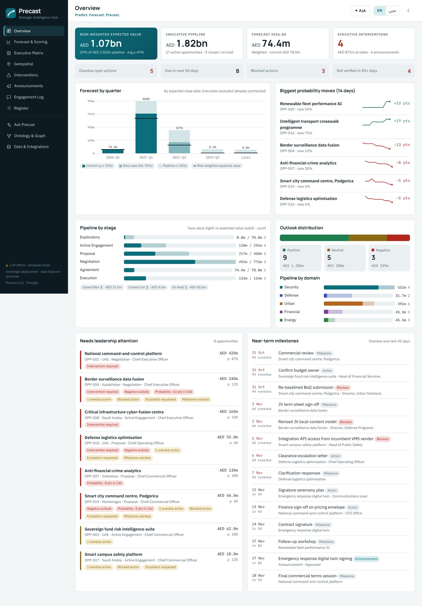
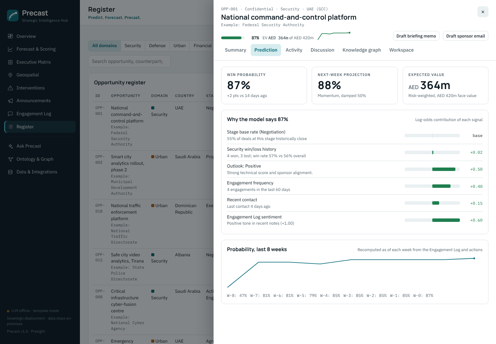
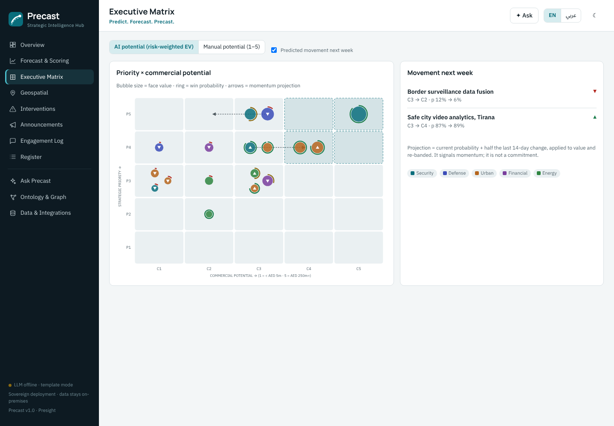
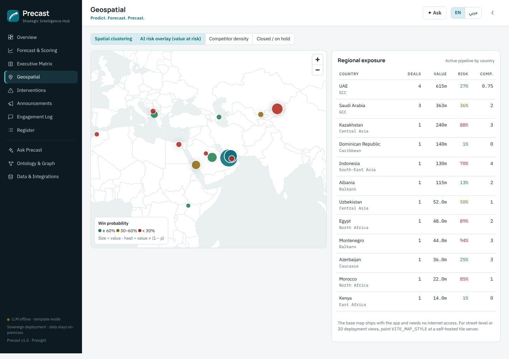
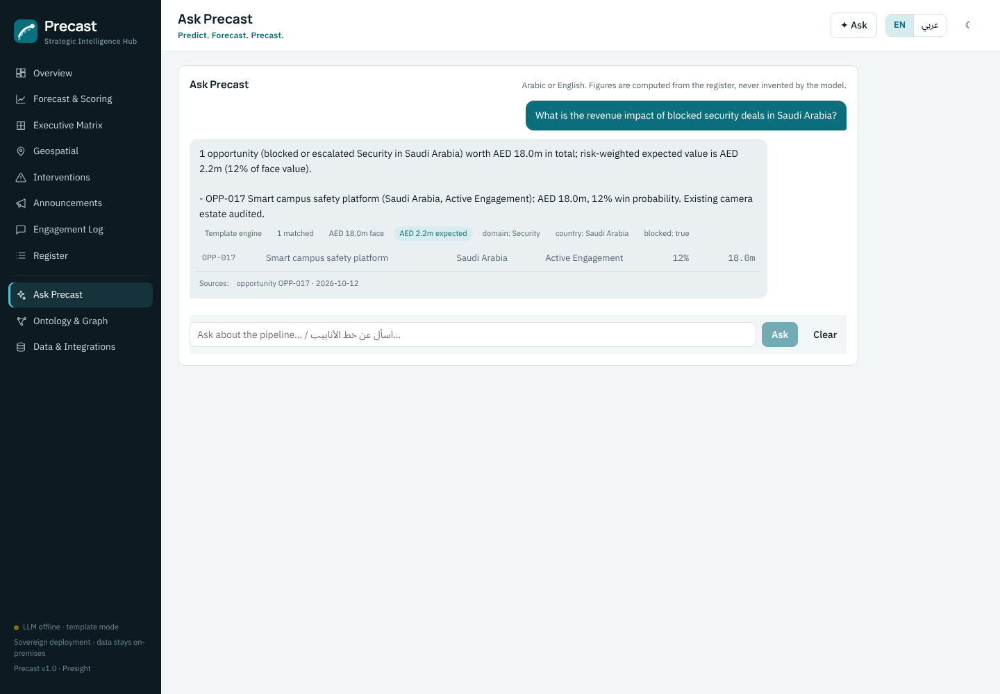
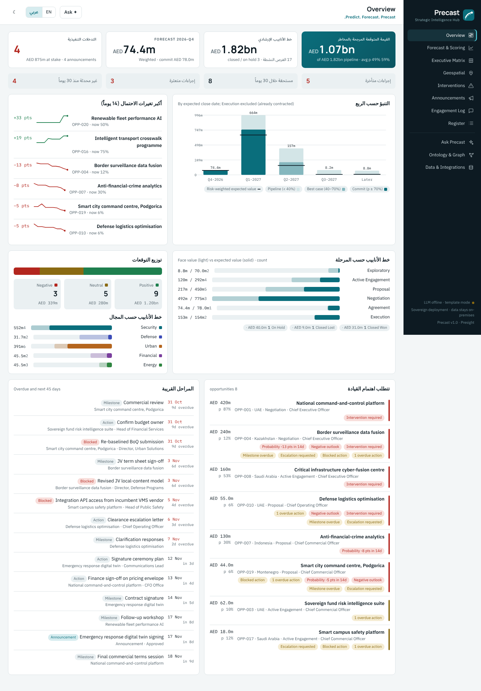

# Precast

**Predict. Forecast. Precast.**
The Strategic Intelligence Hub: an AI-native command centre that turns the strategic opportunities tracker into live win probabilities, risk-weighted forecasts and drafted executive interventions. Everything runs on your own infrastructure with a lightweight local LLM.



*Precast* blends **pre**dictive and fore**cast**: it scores every deal's chance of closing, re-weights the pipeline by that probability and shows where each deal is heading next.

---

## Modules

| Module | What it does | AI / model enhancement |
|---|---|---|
| **Overview** | KPIs, pipeline by stage and domain, outlook, attention list, milestones | Risk-weighted expected value, quarterly forecast, biggest 14-day probability moves |
| **Forecast & Scoring** | Six-quarter forecast (commit / best case / pipeline), scored register | Explainable win probability per deal, 8-week trend, dynamic commercial potential, domain win/loss calibration |
| **Executive Matrix** | 5×5 priority × potential matrix | Toggle manual vs AI (risk-weighted) potential; **predicted movement vectors** for next week |
| **Geospatial** | Opportunities and deployment sites on an offline base map | Spatial clustering, AI value-at-risk heat overlay, competitor-density overlay, regional exposure |
| **Interventions** | Queue of deals needing executive action, ordered by value at risk | **Generative briefing memos and sponsor emails** (English/Arabic), save to Outlook Drafts |
| **Announcements** | Legal / IR / counterparty clearance workflow | **Press-release drafts** with a hard clearance banner: a draft is never shown as cleared until every approval is in |
| **Engagement Log** | Full log, searchable | **LLM entity extraction** from pasted meeting notes → reviewed entry → probability re-scored instantly |
| **Register** | Sortable, filterable register; create opportunities | Inputs normalised through the ontology ("KSA" → Saudi Arabia) |
| **Ask Precast** | Bilingual natural-language Q&A | Question → ontology filters → **computed** answer + retrieved notes; the model never invents figures |
| **Ontology & Graph** | Domain ontology and knowledge-graph explorer | OWL/Turtle and JSON-LD export; per-opportunity neighbourhood graph including prediction factors |
| **Data & Integrations** | Excel template, import/export, CRM API, Microsoft 365 | SharePoint, Teams and Outlook sync |

Every opportunity opens a drawer with **Summary · Prediction · Activity · Discussion · Knowledge graph · Workspace** tabs. *Discussion* is a threaded conversation per opportunity, synced with its Teams channel. *Workspace* links the SharePoint document folder, the Teams channel and Outlook.

| Prediction drawer | Executive matrix with movement vectors |
|---|---|
|  |  |

| Geospatial | Ask Precast |
|---|---|
|  |  |

Arabic interface (right-to-left): 

---

## Quick start

### Docker (recommended)

```bash
cp .env.example .env          # optional settings
docker compose up -d          # Precast + Ollama; pulls qwen2.5:3b-instruct on first run
open http://localhost:8000
```

The first start seeds illustrative data (every counterparty is prefixed `Example:`). Load your own tracker from **Data & Integrations**, or set `PRECAST_SEED=0`.

### Local development

```bash
# API (Python 3.11+)
cd backend
pip install -r requirements.txt
uvicorn app.main:app --reload            # http://localhost:8000, API docs at /docs

# Dashboard (Node 20+)
cd frontend
npm install
npm run dev                              # http://localhost:5173 (proxies /api to :8000)

# Local LLM (optional; Precast falls back to templates without it)
ollama pull qwen2.5:3b-instruct && ollama serve
```

Tests: `cd backend && pytest -q` (20 tests, including mocked Microsoft Graph and LLM endpoints).

---

## The lightweight LLM

| | |
|---|---|
| Default model | `qwen2.5:3b-instruct` via Ollama: bilingual Arabic/English, ~2 GB, runs on CPU or a single small GPU |
| Interface | Any **OpenAI-compatible** endpoint (`PRECAST_LLM_URL`): Ollama, llama.cpp server, vLLM, LM Studio |
| Larger models | Set `PRECAST_LLM_MODEL`, e.g. `qwen2.5:7b-instruct` or `qwen2.5:14b-instruct`; or point at a vLLM server hosting a 70B model on the L40S cluster in the PRD. No code change. |
| Fallback | If the model is unreachable, Q&A, drafting and extraction still work with deterministic templates. The UI shows which engine produced each output. |
| Audit | Every generated draft is logged with its inputs in the `ai_log` table |

**Design principle: the model writes, Python counts.** For "What is the revenue impact of blocked security deals in Saudi Arabia?" the model only maps the question to ontology filters (`domain=Security, country=Saudi Arabia, blocked=true`). The totals are computed from the register, and the model then phrases the answer from those facts. Model output is snapped back onto ontology terms, so a hallucinated domain or stage is discarded.

---

## Predictive scoring

A transparent logistic model, so every probability can be explained to an executive:

```
logit(p) = logit(stage base rate)
         + domain calibration      (historical win/loss ratio, Beta-smoothed toward the global rate)
         + outlook                 (Positive +0.5 · Negative −0.7)
         + engagement frequency    (contacts in last 60 days)
         + recency                 (quiet > 45 days penalised; contact ≤ 10 days rewarded)
         + Engagement Log sentiment (recency-weighted, bilingual lexicon)
         − overdue actions, blocked actions, slipped milestone, competitive field, stale record
```

- **Expected value** = estimated value × p. **Dynamic commercial potential** re-bands the expected value on the same 1–5 scale as the manual score.
- **Expected close** = stage-typical remaining days, stretched for weaker deals. It drives the quarterly forecast: commit (p ≥ 70%), best case (40–70%) and pipeline (< 40%).
- **Trend and movement vectors:** the model is re-run *as of* each of the last 8 weeks. Next-week projection = p + ½ × 14-day change.
- Stacked negative signals are capped (2.2 logits below the stage base), so the model never writes a deal off on its own.
- Every closed deal recorded re-calibrates the domain rates. With enough history, the factor weights can be refitted by logistic regression on the same features.

---

## Ontology

`backend/app/ontology.py` is the single semantic model behind the whole product:

- **Classes:** Opportunity, Counterparty, Country → Region, Site, Domain, Stage, Outlook, Executive Sponsor, Executional Owner, Engagement, Action, Announcement, Approval, Prediction, Score Factor
- **Relations:** `hasCounterparty`, `locatedIn`, `partOfRegion`, `deployedAt`, `inDomain`, `atStage`, `precedes` (transitive), `sponsoredBy`, `hasEngagement`, `hasAction`, `requiresApproval`, `hasPrediction`, `explainedBy`, …
- **Controlled vocabularies** (SKOS) with English and Arabic labels and synonyms: "defence", "KSA", "السعودية", "tender" and "إيجابي" all resolve to canonical terms.

It drives import validation, the Ask Precast parser, LLM grounding prompts and the knowledge graph. Export it from **Ontology & Graph** or from `GET /api/ontology.ttl` (OWL/Turtle) and `GET /api/ontology.jsonld`.

---

## Excel tracker template

**Data & Integrations → Download Excel template**, or [`docs/Precast_Tracker_Template.xlsx`](docs/Precast_Tracker_Template.xlsx).

- Sheets: *Instructions · Opportunities · Engagement Log · Actions & Milestones · Announcements · Lists*. Sheet and column names match the MVP tracker, so existing workbooks load unchanged.
- Dropdowns come from the ontology; header comments explain each field; there is an example row per sheet (skipped on import).
- Import modes: **Merge** (upsert by ID) or **Replace**. Warnings list unknown terms, missing IDs and orphan rows.
- **Export current data** produces the same layout, so the workbook round-trips.

---

## Microsoft 365 integration (SharePoint · Teams · Outlook)

Precast uses Microsoft Graph with an Entra ID **app registration** (client-credentials, app-only).

### 1. Register the app

Entra ID → App registrations → New. Create a client secret, then grant these **application** permissions and admin consent:

| Capability | Graph permission |
|---|---|
| SharePoint tracker sync and opportunity folders | `Sites.ReadWrite.All` (or `Sites.Selected`, scoped to the one site) |
| Teams channel per opportunity | `Channel.Create`, `Team.ReadBasic.All` |
| Teams discussion sync into Precast | `ChannelMessage.Read.All` (protected API: request access from Microsoft) |
| Outlook engagement capture | `Mail.Read`, `Calendars.Read` |
| Outlook drafts and milestone invites | `Mail.ReadWrite`, `Calendars.ReadWrite` |

Restrict mailbox access to the strategy-office mailbox with an **Exchange application access policy**.

### 2. Configure

In **Data & Integrations → Microsoft 365 → Connection settings**, or with environment variables (see `.env.example`): tenant ID, client ID, secret, SharePoint site (`contoso.sharepoint.com:/sites/StrategyOffice`), tracker path, opportunity folder root, Teams team ID, Outlook mailbox. Use **Test connection** to check.

### 3. What it does

| | |
|---|---|
| **SharePoint** | *Pull* the tracker workbook from a document library (merge/replace); *push* the current export back; per opportunity, create a folder (`/Precast/Opportunities/OPP-001 …`) and list its documents in the drawer |
| **Teams** | Create one standard channel per opportunity in the Precast team. *Sync from Teams* imports channel messages and replies into the opportunity's **Discussion** tab (idempotent). Messages posted in Precast are mirrored to the channel through an optional **Teams Workflows webhook**, because Graph does not allow app-only posting to channels. |
| **Outlook** | *Sync mail & calendar* logs emails and meetings into the Engagement Log, which feeds the win probability. Matching uses the subject tag **`[OPP-001]`** (recommended convention) or the counterparty name; re-runs are idempotent. Drafted memos and emails go to **Outlook Drafts** for review; nothing is sent automatically. Milestone meetings can be created as calendar invites. |

Discussions, Outlook-sourced engagements and SharePoint links are included in Ask Precast retrieval and in the intervention memo context.

---

## API

Interactive docs at `/docs`. Main endpoints:

| | |
|---|---|
| `GET /api/overview` · `/api/forecast` · `/api/matrix` · `/api/geo` | Dashboard data |
| `GET/POST/PATCH /api/opportunities[/{id}]` | Register (scored, enriched) |
| `POST /api/ask` | Bilingual Q&A |
| `POST /api/opportunities/{id}/draft` · `/api/announcements/{id}/draft` | Memo / email / press-release drafts |
| `POST /api/engagements/extract` · `POST /api/engagements` | Notes → engagement |
| `GET/POST /api/opportunities/{id}/discussions` | Discussion threads |
| `GET /api/ingest/template` · `GET /api/export` · `POST /api/ingest/xlsx` | Excel template, export, import |
| `POST /api/ingest/crm` | Batch upsert from CRM/ERP connectors (ontology-validated) |
| `GET /api/ontology[.ttl\|.jsonld]` · `GET /api/graph?focus=` | Ontology and knowledge graph |
| `/api/integrations/*` · `/api/opportunities/{id}/{sharepoint,teams,outlook}/…` | Microsoft 365 |

Set `PRECAST_API_KEY` to require an `X-API-Key` header on every write endpoint.

---

## Configuration

| Variable | Default | |
|---|---|---|
| `PRECAST_DB` | `backend/data/precast.db` | SQLite database path |
| `PRECAST_LLM_URL` | `http://localhost:11434/v1` | OpenAI-compatible endpoint |
| `PRECAST_LLM_MODEL` | `qwen2.5:3b-instruct` | |
| `PRECAST_LLM_ENABLED` | `1` | `0` forces template mode |
| `PRECAST_API_KEY` | (empty) | Protects write endpoints |
| `PRECAST_SEED` | `1` | Seed illustrative data when empty |
| `PRECAST_CORS` | `*` | Allowed origins |
| `VITE_MAP_STYLE` | (bundled) | Build-time: self-hosted vector-tile style URL for street-level maps |

## Architecture

```
React + Vite dashboard (MapLibre, offline Natural Earth base map, self-hosted fonts)
        │  /api
FastAPI ─┬─ scoring.py      explainable win probability, forecast, momentum
         ├─ ontology.py     classes, relations, vocabularies, validation, graph, OWL/JSON-LD
         ├─ assistant.py    question → filters → computed answer (+ BM25 retrieval)
         ├─ drafts.py       memos, emails, press releases (clearance-gated)
         ├─ extract.py      meeting notes → Engagement Log entry
         ├─ ingest.py       Excel template, import/export, CRM batch API
         ├─ m365.py         Microsoft Graph: SharePoint, Teams, Outlook
         └─ llm.py          OpenAI-compatible client with template fallback
SQLite (single file; swap for PostgreSQL/PostGIS at scale)      Ollama / vLLM (local)
```

The bundle needs no internet access at runtime (map, fonts and model are all local), which matches the sovereign, air-gapped deployment in the PRD.

### Path to the full PRD architecture
- **Data:** move SQLite to PostgreSQL + PostGIS (the schema is plain SQL); add TimescaleDB or ClickHouse only when engagement volume needs it.
- **Ingestion:** put Kafka in front of `POST /api/ingest/crm` for streaming CRM/IoT feeds.
- **Models:** point `PRECAST_LLM_URL` at vLLM serving a larger bilingual model; add an embedding model to replace BM25 for document-scale RAG and Arabic OCR.
- **Spatial:** CesiumJS / deck.gl 3D layers for BIM digital twins on top of the existing geo API.
- **Security:** SSO (Entra ID OIDC) and row-level access by the `Sensitivity` field.

---

*All seed records are illustrative. Precast v1.0, Presight.*
